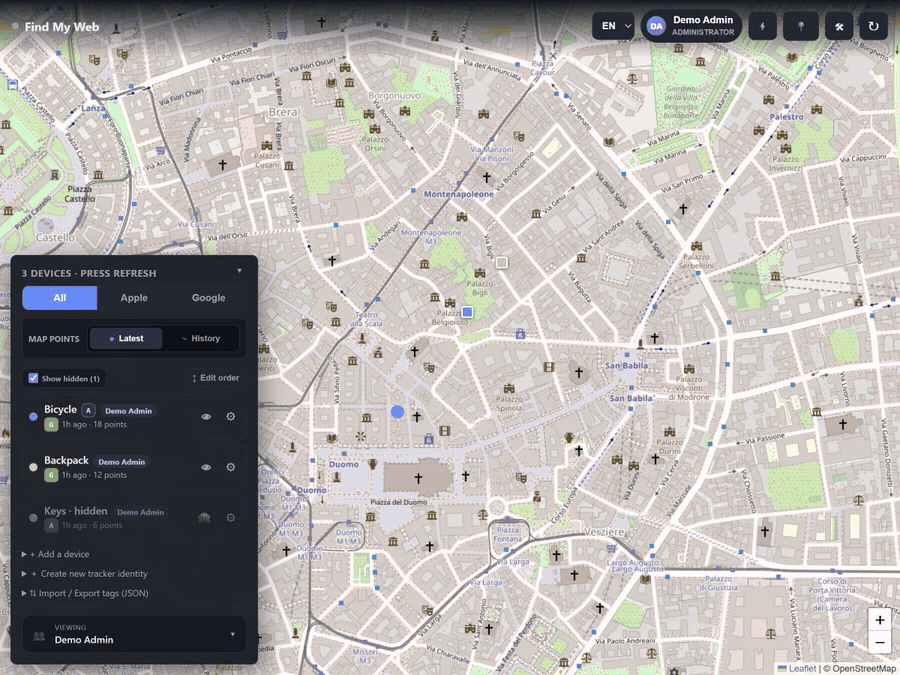
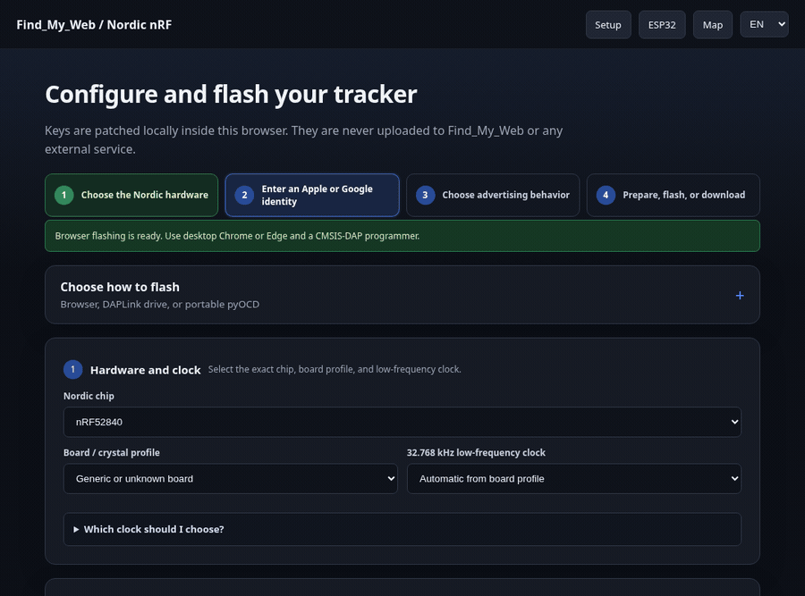
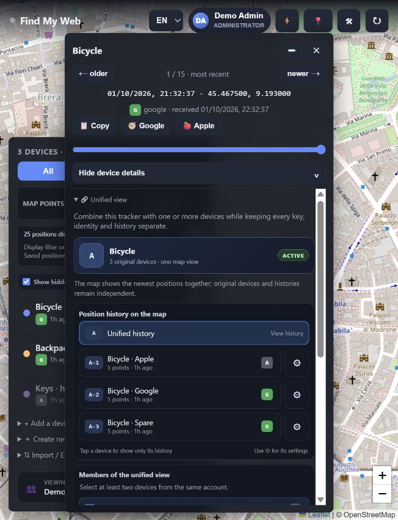
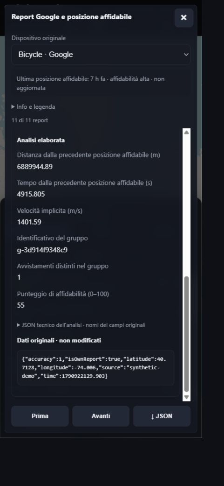
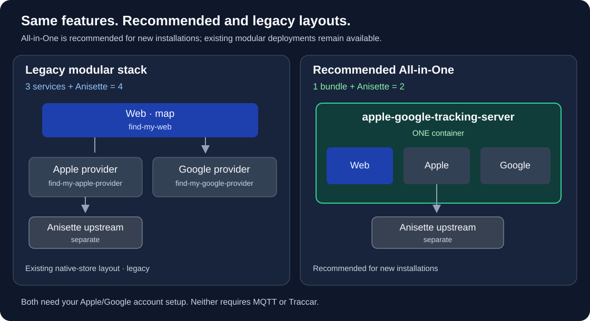

# Apple + Google Tracking Server

**Self-hosted Apple Find My + Google Find Hub tracking, Bluetooth firmware tools and ESP32 libraries.**

[Support development on Ko-fi](https://ko-fi.com/mattboxx) · [Documentation](docs/README.md) · [Screenshots](docs/screenshots/README.md) · [Install](#installation)

## What is this project?

A self-hosted server for **Apple Find My** and **Google Find Hub** Bluetooth
trackers, with one web interface: **Apple + Google Tracking**. Run it on your own NAS,
home server or Docker host, sign in from a phone or computer, and see your devices
on a map with a persistent history of their reported positions.

It is also a **tracker-identity and firmware generator, hardware programming
toolkit, and ESP32 library generator**. Create Apple, Google or dual-network
identities; prepare configured firmware for **nRF52, nRF54L15 and ESP32**;
or generate a ready-to-integrate **FindMyAdv** library for an existing ESP32 project.

The data follows this path: **tracker → nearby phone → Apple/Google network →
provider → this server → your browser**. Provider services handle account
sign-in and retrieve reports: macless-haystack for Apple and a
GoogleFindMyTools-based provider for Google. This server decrypts Apple reports
with your tracker keys, reads Google locations from the provider, and saves
local history. Background polling continues even with the browser closed.
Multiple accounts can share the server while keeping their devices separate.

**It is not a GPS receiver or a new finding network.** Trackers broadcast Bluetooth;
nearby contributing phones relay sightings to Apple or Google. Coverage, latency
and report availability depend on those networks. This unofficial project is not
affiliated with Apple or Google; use only devices you own or are authorized to track.

[](docs/demos/map-history-tour.gif)

Synthetic demonstration: the current map, then history controls.
[Full-size stills and text walkthrough](docs/WORKFLOWS.md).

## What you can do

Keep your backpack and bicycle on one map, check when a device was last seen,
or let household members manage separate trackers on one shared server.
This is useful when your trackers span both finding networks and you want
one interface and your own retained history. Building your own device? Add
finding-network advertising to an existing compatible ESP32 firmware instead
of replacing its main application.

| Capability | What it means |
| --- | --- |
| One map, two networks | View Apple, Google or both sources without switching apps. |
| Local history | Browse past reports, select a date/time range and inspect each point. |
| Reliable Google locations | Compare Optimized, Raw and Both views; retain original reports. |
| Reversible unified views | Display several trackers as one object without merging or deleting identities. |
| Separate user accounts | Manage ownership and roles; administrators control shared connections. |
| Optional integrations | Publish to MQTT/Home Assistant or an existing Traccar Server. |
| Identity and firmware generation | Create Apple, Google or dual-network identities and configured tracker firmware. |
| Hardware programming | Configure and program nRF52, nRF54L15 and supported ESP32 boards. |
| ESP32 library generation | Download a configured FindMyAdv library and examples to integrate into your own firmware. |

The interface supports EN, IT, ES, FR, RU and Simplified Chinese, with a persistent
browser preference. Firmware tools and integrations are optional, not prerequisites.

## Screenshots and walkthroughs

### Generate firmware and program your hardware

[](docs/demos/hardware-library-tour.gif)

Generate identities and configured firmware, select a board and tune its
advertising settings. **nRF52** uses browser SWD flashing or a portable pyOCD ZIP;
**nRF54L15** uses the ZIP/pyOCD route, not direct browser flashing. **ESP32** uses
WebSerial or downloaded files. [ESP32 page](docs/screenshots/12-esp32-flasher.jpg) ·
[Nordic page](docs/screenshots/14-nrf-flasher.jpg).

### Add finding-network support to your own ESP32 firmware

The page also generates a **configured FindMyAdv ZIP**: library source,
ready-to-copy examples and an optional PlatformIO profile. Integrate it into an
existing **Arduino/PlatformIO firmware on a BLE-capable ESP32**, keeping your
application's purpose and main loop. [Library and integration guide](https://github.com/Mattboxx/Apple-Google-Tracking-Esp32-Library).

<details>
<summary>More examples: unified views and Google report analysis</summary>

[](docs/screenshots/04-unified-view.jpg)

[](docs/screenshots/18-google-reliable-reports.jpg)

Original reports remain available separately from the derived reliable point.
Pending candidates and outliers are classified, not silently removed.
[Analysis behavior and parameters](docs/GOOGLE_RELIABLE_LOCATION.md).

</details>

The previews show the real interface (earlier branding) with synthetic data or empty keys, with no
board connected. [19 stills](docs/screenshots/README.md) · [Workflows and limits](docs/WORKFLOWS.md).

## Installation

Requires Docker with Compose and an `amd64` or `arm64` host. You will also need
the relevant Apple/Google account setup and compatible tracker identities.
Installing the containers does not automatically authenticate those accounts.

**Apple account prerequisite:** sign in on an Apple device at least once and
activate iCloud (**the free 5 GB plan is enough**). You can remove that device
from the account afterwards. [Account setup details](docs/INSTALLATION.md#apple-account-prerequisite).

**Google account prerequisite:** at least one device already registered on
**Google Find Hub**. Maximum network coverage ("With network in all areas")
is recommended. [Account setup details](docs/INSTALLATION.md#google-account-prerequisite).

| Layout | What runs | Total |
| --- | --- | --- |
| **All-in-One (recommended)** | `apple-google-tracking-server` bundles web + Apple + Google; Anisette remains separate | **2 containers** |
| **Modular (legacy)** | Separate web, Apple and Google services, plus Anisette | **4 containers** |

Use **All-in-One for new installations**. The four-container modular stack is
**legacy**, retained for existing deployments and the current native-store entry.
Both offer the same web features; existing installations do not migrate automatically.

### All-in-One — fresh Linux server

```sh
mkdir apple-google-tracking && cd apple-google-tracking
curl -fsSL https://raw.githubusercontent.com/Mattboxx/Find_My_Hub_Docker_Appstores/main/all-in-one/compose.yaml -o compose.yaml
mkdir -p data/anisette
sudo chown 1000:1000 data/anisette
docker compose up -d
```

Open **`http://SERVER_IP:8125`**, create the administrator and complete **Setup**.
The directory ownership step is for Linux only. For Windows Docker Desktop,
custom paths, backups or migration, read the [All-in-One guide](https://github.com/Mattboxx/Find_My_Hub_Docker_Appstores/blob/main/all-in-one/README.md).

### Legacy modular stack or app store

For an existing modular deployment or an explicit legacy installation:

```sh
mkdir tracking-modular && cd tracking-modular
curl -fsSL https://raw.githubusercontent.com/Mattboxx/Find_My_Hub_Docker_Appstores/v1.1.21/compose.yaml -o compose.yaml
docker compose up -d
```

For ZimaOS/CasaOS, add this **JSON source** (Apple + Google Tracking Server), then install Apple + Google Tracking:

```text
https://cdn.jsdelivr.net/gh/Mattboxx/Find_My_Hub_Docker_Appstores@gh-pages/store.json
```

[Other stores and panels](docs/STORES.md) · [Full installation guide](docs/INSTALLATION.md)

<details>
<summary>Architecture, image names and existing providers</summary>

[](docs/images/deployment-options.svg)

Anisette is a separate upstream Apple authentication helper in both layouts.
Fewer containers do not automatically mean lower memory usage or less account setup.

The bundle is `ghcr.io/mattboxx/apple-google-tracking-server`; tags `1.1.21`,
`stable` and `latest` are available. The legacy name `find-my-hub` stays compatible.
`find-my-web` is **web-only**, not a bundle alias. Keep the current data mounts,
ports and Compose project name when changing only an image reference.

Already running standard compatible providers? Deploy only the web service and
set their reachable URLs in administrator Setup. [Compatibility and endpoints](docs/INSTALLATION.md#existing-standard-providers-web-only).

</details>

## First run

1. Create the administrator, then configure only the providers you need in **Setup**.
2. Complete Apple authentication/2FA or the upstream Google login/secrets flow.
3. Import or generate tracker identities, then explicitly create each device.
4. Wait for a network sighting and inspect the reported timestamp on the map.

A registered device or healthy container does not guarantee a recent sighting.
An ordinary server update does not require new keys, registration or firmware.
[Follow the illustrated user guide](docs/USER_GUIDE.en.md).

## Documentation

| I want to… | Read |
| --- | --- |
| Understand the interface | [Illustrated user guide](docs/USER_GUIDE.en.md) |
| Install, update or migrate | [Installation and operations](docs/INSTALLATION.md) |
| Install through a store | [ZimaOS, CasaOS, Portainer, Umbrel and Runtipi](docs/STORES.md) |
| See each workflow | [Demonstrations](docs/WORKFLOWS.md) and [gallery](docs/screenshots/README.md) |
| Understand Google reliability | [Raw reports and reliable locations](docs/GOOGLE_RELIABLE_LOCATION.md) |
| Find project files or contribute | [Documentation index](docs/README.md) |

<details>
<summary>Italian documentation</summary>

[Guida illustrata in italiano](docs/USER_GUIDE.it.md). English is the primary
language of this repository; the web interface still supports all six languages.

</details>

## Updates and data safety

Back up web data **and** Apple, Google and Anisette state. Keep your current
deployment layout, then run in its Compose directory:

```sh
docker compose pull
docker compose up -d
```

Pinned version tags change only when you edit the version. `latest` and `stable`
track stable bundles but do not update running containers by themselves.
**Never use `docker compose down -v` on a real installation or delete its data.**
Do not run modular and bundled deployments against the same data simultaneously.

Keep provider APIs inside a trusted LAN/VPN; protect remote web access with HTTPS.
Never publish credentials, tracker keys, backups or personalized firmware ZIPs.
Public images contain application code; the source repository remains **private**.

## Credits, licensing and support

Built on [macless-haystack](https://github.com/dchristl/macless-haystack),
[GoogleFindMyTools](https://github.com/leonboe1/GoogleFindMyTools) and its
[Google provider fork](https://github.com/traccar/google-find-hub-sync), with
Leaflet and OpenStreetMap. Third-party projects retain their own licenses.
[Full upstream acknowledgements](ACKNOWLEDGEMENTS.md) · [License and source notices](docs/LICENSING.md).

If Apple + Google Tracking helps you, consider [buying me a coffee on Ko-fi](https://ko-fi.com/mattboxx)
to support continued maintenance, clearer guides and new improvements.
Donations are optional; every feature remains available without donating.
