# Illustrated workflows

[Project overview](../README.md) · [User guide](USER_GUIDE.en.md) · [Complete gallery](screenshots/README.md)

[Short animated tours](demos/README.md) preview the map/history, Nordic/ESP32 programming and configured libraries.
All examples use synthetic accounts, identities and locations. These screenshots
document interface behavior, not a live Apple/Google connectivity test.

## 1. Review a journey without losing older points

Select a device → **History / Storico** → choose all data, 24 hours, 7/30 days
or a custom time range → navigate with previous/next and the slider. Filtering
changes what is displayed; it does not delete stored history or change MQTT.

Mobile demonstration: history remains visible above the controls

The bottom history controls retain timestamp, source and point details. Map
padding keeps the selected point in the visible part of the map. Collapse
details if you need more room; the historical data remains accessible.

## 2. Combine several trackers into one reversible view

Open a device's settings → configure its **Unified view / Vista unificata** →
select same-account members. The logical view uses the newest applicable
provider positions, with member badges. Open any original member's settings or
show only that member's history. Unlinking does not delete keys or locations.

See original-member settings and guarded identity changes

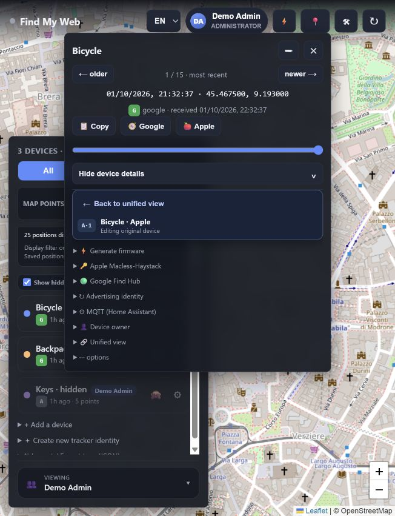

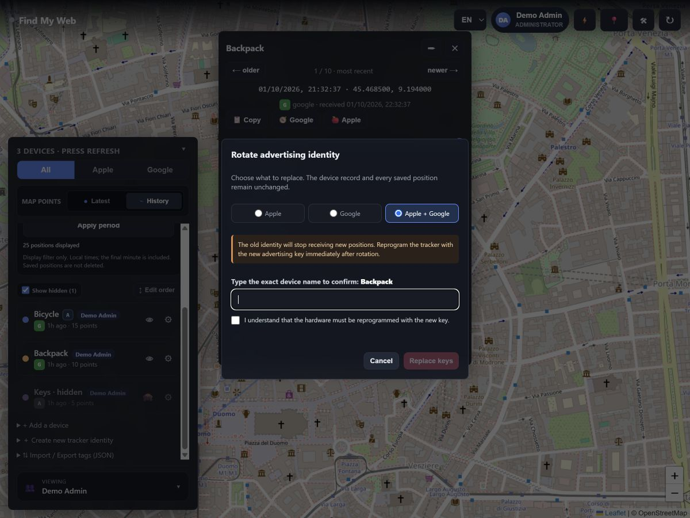

Identity rotation changes tracker keys and may require reprogramming the
physical device. It is deliberately confirmed, not part of merging, splitting
or updating a container.

## 3. Understand Google reports instead of following every newest point

Choose **Optimized**, **Raw** or **Both**. Reliable-location analysis considers
consensus, clustering and plausible movement; a lone far-away report can remain
pending rather than move the map. The raw archive stays available separately.
Open **Reports** to inspect classifications, confidence and original fields.

See Google reports and administrator reliability settings

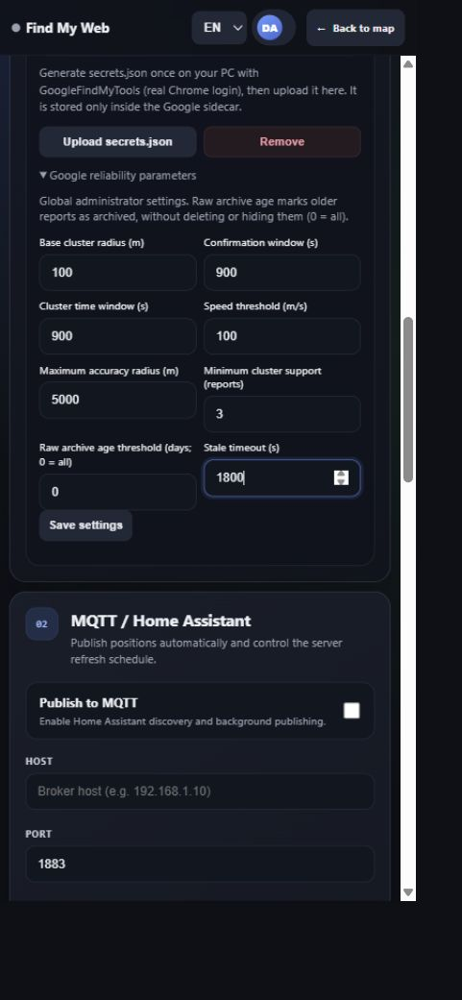

Advanced global parameters are in administrator Setup. Collapsed developer
tools stay at the bottom of the device panel. An optimized point is an estimate,
not a guarantee; consult raw reports whenever you need the original evidence.

## 4. Configure accounts, connections and optional integrations

Administrators manage users, device ownership, provider setup and infrastructure.
Ordinary users manage their own devices and identities; they cannot change
shared provider addresses or MQTT settings.

See account management, provider setup, MQTT and Traccar

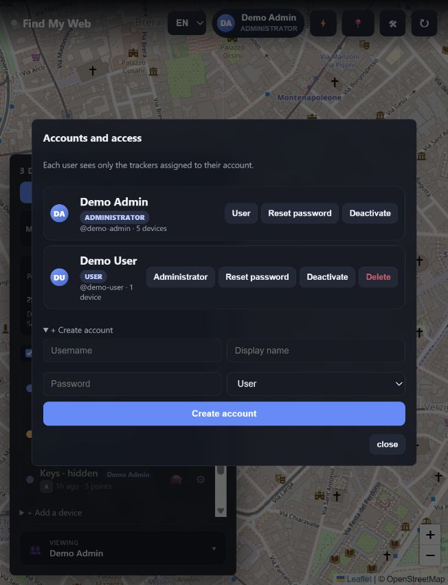

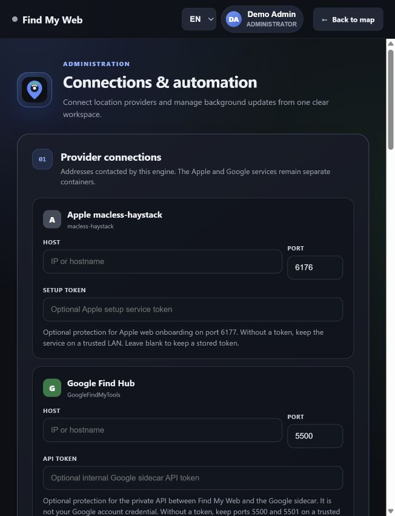

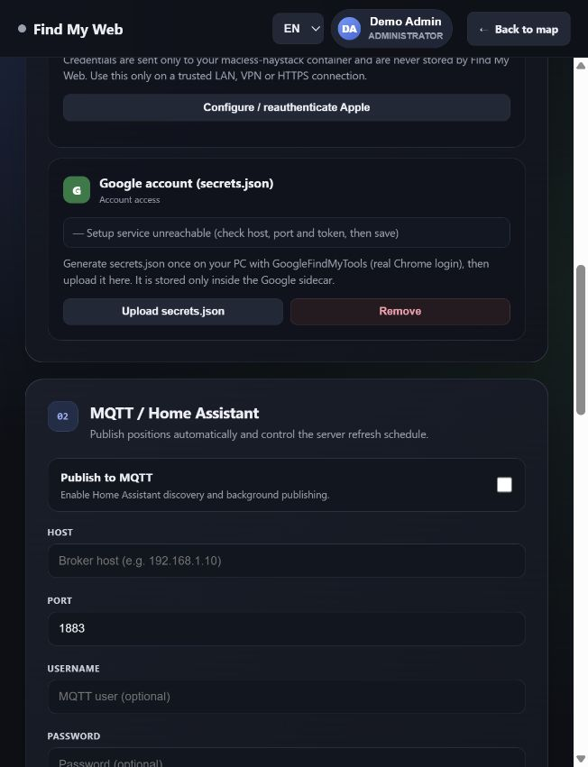

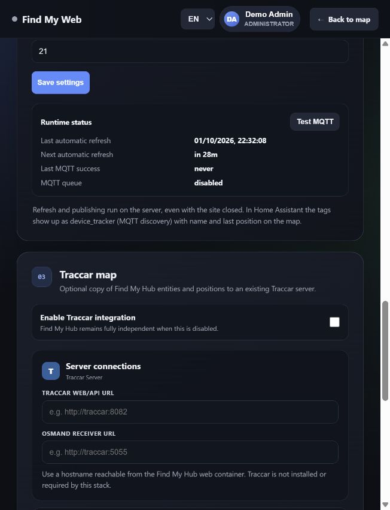

MQTT/Home Assistant and an existing Traccar Server are optional and disabled by
default. Find My Hub still owns its accounts, devices, history and map when
either integration is absent. The Google provider fork named “traccar” is not
the optional Traccar Server map integration.

## 5. Back up first; generate identities or firmware only when needed

Use administrator backup for complete web data; selective JSON export is not a
replacement for a complete backup. Apple, Google and Anisette state require their
own backups too. After generating an identity you can choose whether to create
a device, then use its firmware shortcuts with prefilled advertisement values.

See backups, identity generation and firmware tools

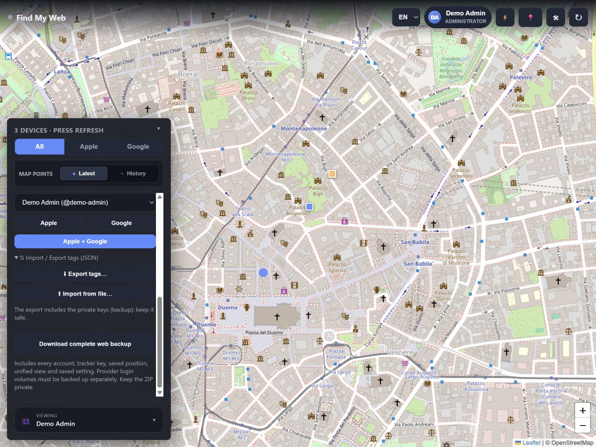

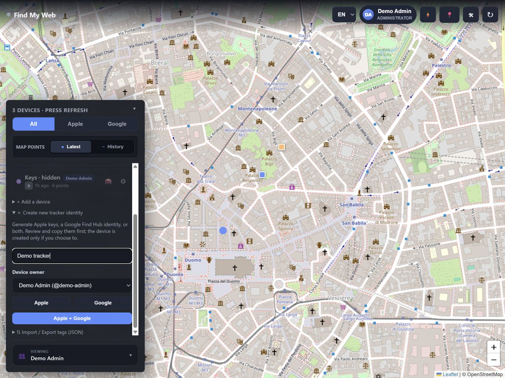

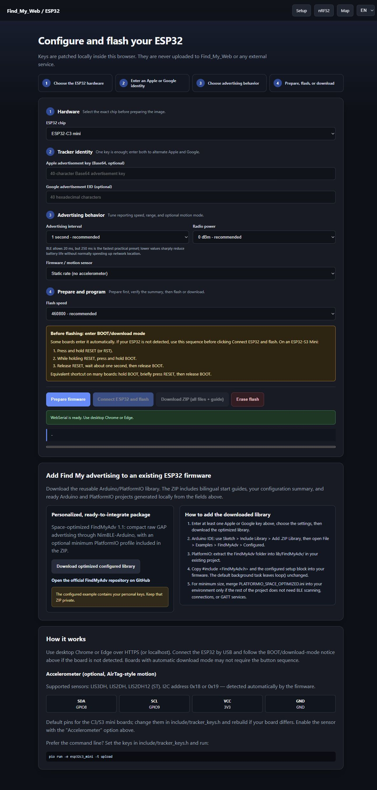

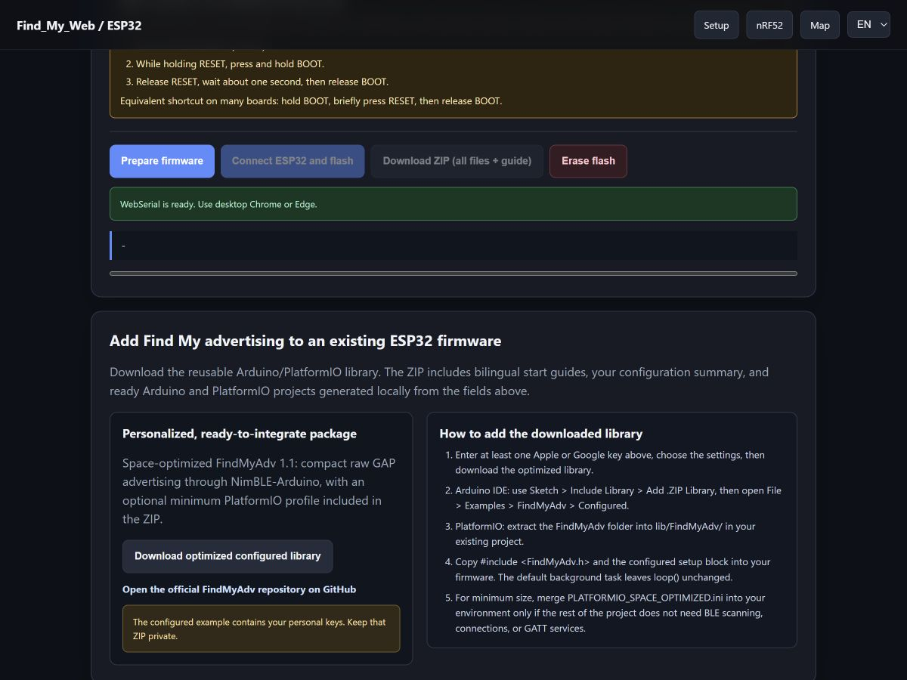

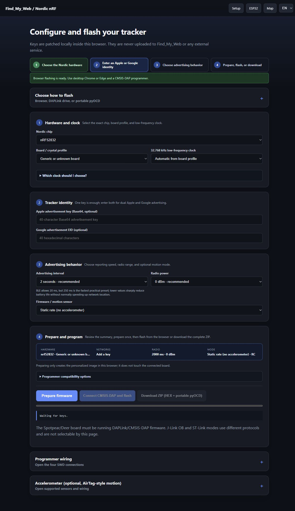

Firmware tools are optional. Screenshots describe controls, not a new hardware
compatibility test. Never publish a personalized firmware ZIP: it contains your
tracker's advertisement values. Firmware and key behavior are unchanged here.

