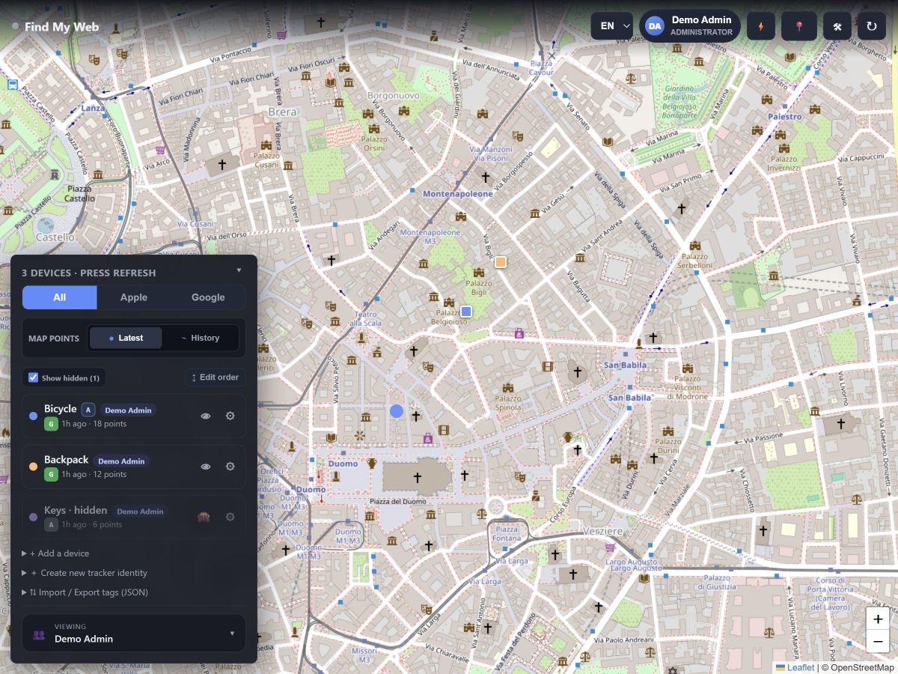
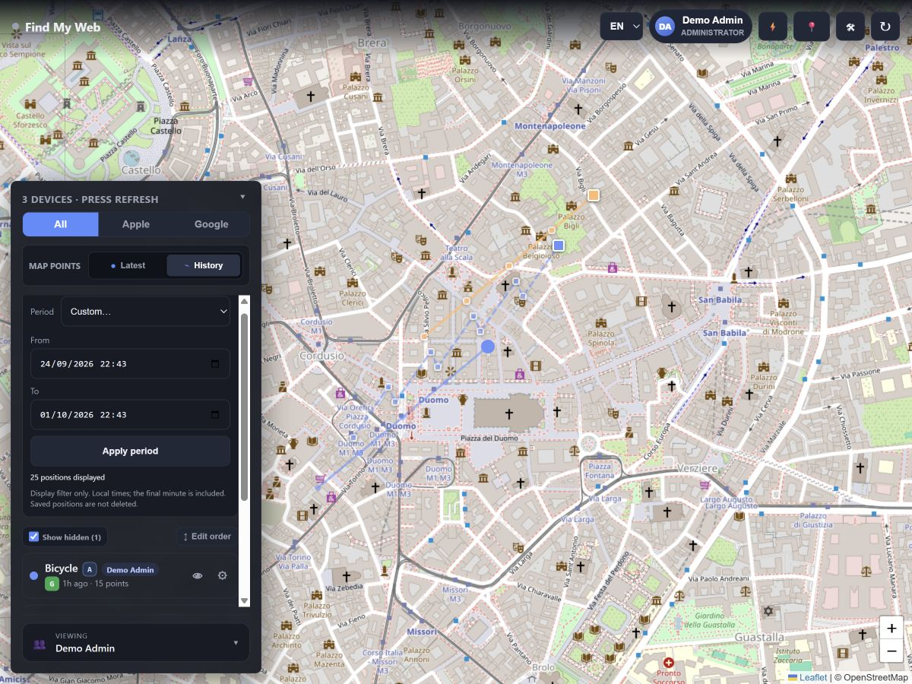
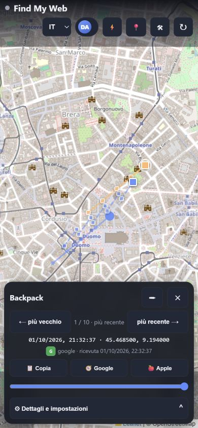

# Interface gallery

Captured from Find My Hub 1.1.15 and the 1.1.16/1.1.17/1.1.18 feature previews in isolated Docker environments with synthetic
devices, accounts, identities and locations. No real credentials or personal
tracking data were used. Provider services in this demo are unconfigured;
screenshots document controls, not a claim of live Apple/Google connectivity.
Open an image for its full-size version. Map attribution is retained.
The Google report image shows the compact 1.1.18 mobile layout with an expanded
report; explanatory text remains available under the collapsed Info and legend.

[English user guide](../USER_GUIDE.en.md) · [Animated tours](../demos/README.md)

Italian documentation

Schermate reali con dati dimostrativi, non informazioni personali.
[Guida italiana](../USER_GUIDE.it.md).

| Feature | Screenshot |
| --- | --- |
| Sign in | [01-login.jpg](01-login.jpg) |
| Map, sources, visibility | [02-map.jpg](02-map.jpg) |
| History date/time range | [03-history-range.jpg](03-history-range.jpg) |
| Unified views and members | [04-unified-view.jpg](04-unified-view.jpg) |
| Original-device settings | [05-device-settings.jpg](05-device-settings.jpg) |
| Apple/Google identity generation | [06-identities.jpg](06-identities.jpg) |
| Accounts and roles | [07-users.jpg](07-users.jpg) |
| Provider connections and onboarding | [08-provider-setup.jpg](08-provider-setup.jpg) |
| MQTT, Home Assistant and polling | [09-mqtt.jpg](09-mqtt.jpg) |
| Optional Traccar map | [10-traccar.jpg](10-traccar.jpg) |
| JSON export and complete backup | [11-backup.jpg](11-backup.jpg) |
| ESP32 flashing and BOOT guidance | [12-esp32-flasher.jpg](12-esp32-flasher.jpg) |
| Space-optimized configured library | [13-esp32-library.jpg](13-esp32-library.jpg) |
| Nordic boards, clock and motion | [14-nrf-flasher.jpg](14-nrf-flasher.jpg) |
| Mobile history navigation | [15-mobile-history.jpg](15-mobile-history.jpg) |
| Deliberate reordering | [16-order.jpg](16-order.jpg) |
| Deliberate identity rotation | [17-identity-rotation.jpg](17-identity-rotation.jpg) |
| Google raw archive and reliable result | [18-google-reliable-reports.jpg](18-google-reliable-reports.jpg) |
| Administrator reliability settings | [19-google-analysis-settings.jpg](19-google-analysis-settings.jpg) |

Maintenance: recapture only in a disposable environment, inspect every image
before publishing, and synchronize this directory and both guides with the
store catalog. Never capture a production map or reveal its identity fields.
